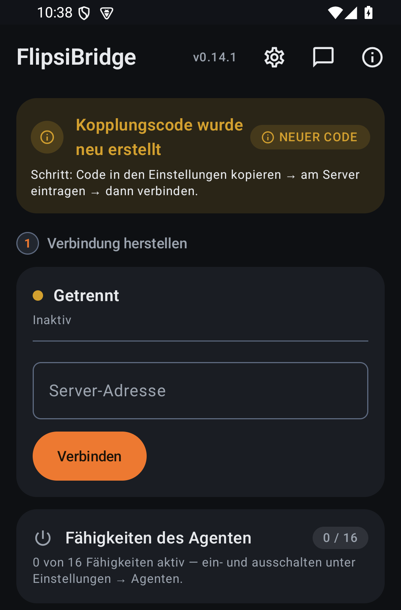
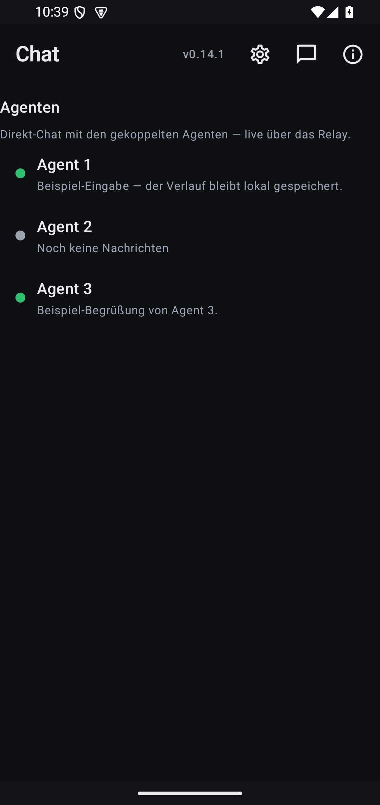

# FlipsiBridge

**Remote Android device control for AI agents.** Self-hosted, MIT-licensed: give your AI agent hands on your phone — voice, camera, screen, files, notifications, health and 58 device actions. Chat and media are end-to-end encrypted with a Double Ratchet (the relay sees only ciphertext); device commands travel over your own TLS-authenticated relay. Built for the [Hermes Agent](https://github.com/NousResearch/hermes-agent) ecosystem.


[](https://github.com/TechFlipsi/FlipsiBridge/actions/workflows/build.yml)
[](https://github.com/TechFlipsi/FlipsiBridge/actions/workflows/python.yml)


A community **Hermes Android companion app** — FlipsiBridge builds the connection between your phone and the Hermes Agent Gateway: encrypted agent chat (Double Ratchet, the relay sees only ciphertext) plus 58 device tools over your own TLS-authenticated relay. Everything behind the gateway is your setup — FlipsiBridge doesn't touch it. Installable today from GitHub releases — no beta invite required.

> ⚠️ Not affiliated with Nous Research — community project (TechFlipsi), listed in the official [plugin catalog](https://hermes-agent.nousresearch.com/docs/plugins/hermes-android) and on [hermesatlas.com](https://hermesatlas.com).

## Screenshots
<p align="center">
  
&nbsp;&nbsp;
  
</p>

## Features
- **End-to-end encrypted chat** — Double Ratchet (X25519 + X3DH + AES-256-GCM) phone <-> agent; the relay sees only ciphertext
- **Multi-agent chat** — multiple agents in one app: status chips (sent/delivered/read), presence, offline spool (24 h), second-device live status
- **58 device tools** — camera, screen, screen recording, files, notifications, microphone streaming, media, clipboard, SMS, calls, apps, alarm/timer, torch, Health Connect
- **mTLS device enrollment** — per-device client certificates enforced at the reverse proxy (default-deny: no cert, no chat routes)
- **Hardened by default** — the installer ships a sandboxed systemd unit (own service user, `ProtectSystem=strict`), secrets at 0640, auth lockouts active from day one
- **Health Connect integration** — read-only aggregates (steps, heart rate, sleep), default OFF per capability
- **OEM compatibility profiles** — Xiaomi/HyperOS, Samsung/One UI, OPPO/realme/OnePlus, VIVO/iQOO, Huawei/Honor, Motorola, Nothing + generic AOSP fallback
- **Two editions, one codebase** — GitHub edition (full features) and Play edition (Google-compliant, per flavor)
- **Capability gating** — every device permission is an explicit opt-in switch, default denied
- **Connects out, works behind NAT** — no port forwarding, no VPN; the phone opens the WebSocket to your own server

## How it works

```
Phone (anywhere, NAT ok) ──mTLS + WebSocket──> Your relay (server :8766) <──HTTP/WS── AI agent(s)
             │ Double-Ratchet E2E chat — the relay sees only ciphertext
             └── 58 android_* device tools via accessibility + system APIs
```

The phone connects **out** to your relay — works behind any NAT, no port forwarding, no VPN, no USB. Pairing is a code shown in the app; enrollment binds the device to a client certificate.

## Quickstart

### 1. Server — one command

```bash
curl -fsSL https://raw.githubusercontent.com/TechFlipsi/FlipsiBridge/main/install-relay.sh | bash
```

The interactive installer downloads all backend files, **verifies every file against the signed SHA-256 release manifest** (mismatch = abort, fail-closed), creates a dedicated `flipsibridge` system user, installs a sandboxed systemd unit, and activates auth lockout limits (3 failed attempts → 10-minute IP block). It asks before touching anything — and can set up Nginx Proxy Manager for you (install or configure) if you want one. Removing is just as granular: `install-relay.sh uninstall` asks what to remove and what to keep.

- Illustrated step-by-step install & uninstall: [docs/INSTALL-GUIDE.md](docs/INSTALL-GUIDE.md)
- Maximum-security setup with verify commands: [docs/SECURITY-SETUP.md](docs/SECURITY-SETUP.md)
- Let an AI agent do the whole setup: [docs/AGENT_SETUP.md](docs/AGENT_SETUP.md)

### 2. Install the app on your phone

Download the current signed APK from [**Releases**](https://github.com/TechFlipsi/FlipsiBridge/releases), or the auto-published debug build from [**Latest Build**](https://github.com/TechFlipsi/FlipsiBridge/releases/tag/latest-build), or build from source:

```bash
cd hermes-android-bridge
./gradlew assembleGithubDebug
adb install app/build/outputs/apk/github/debug/flipsibridge-*-github.apk
```

> The Latest-Build APK is a debug build — Android/Play Protect may warn on install. Prefer the signed release APKs for regular use.

### 3. Grant permissions on the phone

- Tap **Enable Accessibility Service** → find Hermes Bridge → toggle ON
- Tap **Enable Status Overlay** and **Grant Screen Recording** → approve the dialogs
- Grant extra runtime permissions per tool you want (microphone, location, contacts, SMS, phone) — see the [permissions table](#permissions)
- Enable **Notification Listener** under *Settings > Special app access > Notification access*

### 4. Pair

Tell your agent (via Telegram, Discord, …): `Connect to my phone, code is <CODE>` — the code is shown in the app. Done. Try: *"open Instagram"*, *"take a screenshot"*, *"what apps do I have?"*

## Tools (58)

The full tool registry lives in [`hermes-android-plugin/plugin.yaml`](hermes-android-plugin/plugin.yaml) (single source of truth). Overview:

| Category | Tools |
|----------|-------|
| Connectivity & status | `android_setup`, `android_ping`, `android_network_status` |
| Screen & interaction | `android_read_screen`, `android_screenshot`, `android_screen_record`, `android_tap`, `android_tap_text`, `android_type`, `android_swipe`, `android_scroll`, `android_press_key`, `android_long_press`, `android_drag`, `android_pinch`, `android_wait`, `android_find_nodes`, `android_describe_node`, `android_diff_screen`, `android_screen_hash`, `android_events`, `android_event_stream`, `android_read_widgets` |
| Apps | `android_open_app`, `android_get_apps`, `android_current_app`, `android_apk_install` |
| Communication | `android_send_sms`, `android_call`, `android_search_contacts`, `android_notifications`, `android_notify_reply` |
| Media & sensors | `android_mic_record` / `android_mic_stop` / `android_mic_status` / `android_mic_fetch`, `android_media`, `android_photo`, `android_speak`, `android_speak_stop`, `android_torch`, `android_volume`, `android_location`, `android_health` |
| Files | `android_file_get`, `android_file_put`, `android_file_delete`, `android_files_list`, `android_files_count`, `android_files_search`, `android_files_permission` |
| Automation & misc | `android_macro`, `android_alarm`, `android_timer`, `android_broadcast`, `android_send_intent`, `android_clipboard_read`, `android_clipboard_write` |

Microphone recordings use the speech-oriented Android audio source with bounded PCM gain. The bridge retains the 10 newest completed WAV files and removes older ones after successful finalization.

## Permissions

| Permission | How to Grant | Required For |
|------------|-------------|--------------|
| Accessibility Service | App button → Settings > Accessibility | All tools (core requirement) |
| System Alert Window (Overlay) | App button → Settings > Draw over apps | Status overlay display |
| Screen Recording (MediaProjection) | App button → approve system dialog | `android_screen_record` |
| Microphone | Settings > Apps > Permissions > Microphone | `android_mic_record` |
| Location | Settings > Apps > Permissions > Location | `android_location` |
| Read Contacts | Settings > Apps > Permissions > Contacts | `android_search_contacts` |
| Send SMS | Settings > Apps > Permissions > SMS | `android_send_sms` |
| Call Phone | Settings > Apps > Permissions > Phone | `android_call` (auto-dial) |
| Notification Listener | Settings > Special app access > Notification access | `android_notifications`, `android_events` |

## Repository structure

| Component | Path | Language | Purpose |
|-----------|------|----------|---------|
| **Android bridge app** | `hermes-android-bridge/` | Kotlin | Runs on the phone. Connects to the server via WebSocket + mTLS, executes commands via AccessibilityService |
| **Python toolset** | `tools/`, `tests/` | Python | Runs on the server. 58 `android_*` tools + WebSocket relay (`android_relay.py`) |
| **hermes plugin package** | `hermes-android-plugin/` | Python | Drop-in plugin for hermes-agent (`plugin.yaml`, tools, loader-registered skill) |
| **Chat adapter (deploy path)** | `contrib/hermes-chat-plugin/adapter.py` | Python | Production chat adapter — installs to `~/.hermes/plugins/flipsibridge-chat/` |
| **Installer** | `install-relay.sh` | Bash | Signed, interactive, hardened server install + granular uninstall |
| **Deployment & utilities** | `deployment/`, `contrib/` | systemd, bash | Hardened unit template, CA utility (`flipsibridge-ca.sh`), daemon wrapper |
| **Agent skills** | `skills/` | Markdown | Ready-to-install Hermes skills (see below) |

> The Python code exists for standalone development and testing (`pip install -e .`, `pytest`). The Android app does not use or depend on the Python files. The Android head-unit variant is documented in [docs/aaos.md](docs/aaos.md).

## Security

See [SECURITY.md](SECURITY.md) for the model and [docs/SECURITY-SETUP.md](docs/SECURITY-SETUP.md) for the full hardened setup. Key points:
- **E2E chat**: Double Ratchet — the relay only ever sees ciphertext
- **mTLS default-deny**: no client certificate → no chat routes (rejected at the reverse proxy)
- **Auth lockout**: 3 failed attempts → 10-minute IP block; pairing window capped; replay window enforced
- **Sandboxed relay**: own `flipsibridge` system user, `ProtectSystem=strict`, syscall whitelist, secrets 0640
- **Signed deployment**: installer verifies every downloaded file against the release manifest (fail-closed)
- **Transport**: native TLS (`ANDROID_RELAY_TLS=1` + cert/key, `wss://`) or TLS reverse proxy — the relay refuses plaintext binds off-localhost by default
- **Phone connects out** — the device is never directly exposed
- Full device access once paired — only connect to your own, trusted server

## For AI agents

Two ready-to-install Hermes skills ship in this repo — copy them into your agent's skills directory and it knows FlipsiBridge inside out:

```bash
cp -r skills/flipsibridge skills/android ~/.hermes/skills/   # adjust path to your Hermes install
```

- **`skills/flipsibridge`** — full software knowledge: architecture, routes & auth model, environment variables, install/update/uninstall, verify recipes, operating rules, symptom→fix table. Contains **no private data** — safe to install anywhere.
- **`skills/android`** — how to actually drive the phone (mirror of the loader-registered `hermes-android-plugin/skill.md`).

Agent-driven installation prompt: [docs/AGENT_SETUP.md](docs/AGENT_SETUP.md).

## Documentation

| Doc | What it covers |
|-----|----------------|
| [docs/INSTALL-GUIDE.md](docs/INSTALL-GUIDE.md) | Autoinstallation & uninstall, illustrated (step-by-step, for humans and agents) |
| [docs/SECURITY-SETUP.md](docs/SECURITY-SETUP.md) | Maximum-security setup with verify commands per step |
| [docs/AGENT_SETUP.md](docs/AGENT_SETUP.md) | Complete setup delegated to an AI agent (copy-paste prompt) |
| [docs/quickstart.md](docs/quickstart.md) | Phone under agent control in ~5 minutes |
| [docs/install.md](docs/install.md) | Full reference install (plugin + APK + permissions + dev) |
| [docs/architecture.md](docs/architecture.md) | Data flow, command envelope, app & relay internals |
| [docs/configuration.md](docs/configuration.md) | All environment variables and options |
| [docs/troubleshooting.md](docs/troubleshooting.md) | Known issues and workarounds |
| [docs/aaos.md](docs/aaos.md) | Running on Android Automotive car head units |
| [docs/manual-tests.md](docs/manual-tests.md) | On-device manual test procedures |
| [docs/RELEASING.md](docs/RELEASING.md) | Release checklist |
| [docs/spec.md](docs/spec.md) | Goals, non-goals, compatibility commitments |
| [deployment/README.md](deployment/README.md) | Hardened systemd migration (pre-installer setups) |
| [SECURITY.md](SECURITY.md) · [CHANGELOG.md](CHANGELOG.md) · [CONTRIBUTING.md](CONTRIBUTING.md) | Security model · every release · how to contribute |

## Development

```bash
# Python toolset
pip install -e ".[dev]"
python -m pytest tests/

# Android app
cd hermes-android-bridge
./gradlew assembleGithubDebug
```

## Other agent frameworks (OpenClaw & co.)

FlipsiBridge's agent-facing side is deliberately thin: the **wire protocol between your phone and the relay is agent-framework-agnostic** — the E2E-encrypted channel (Double Ratchet) terminates at *your* relay, and only a small adapter layer connects that relay to your agent runtime's tool system. Today a first-class adapter ships for **Hermes Agent**. The same pattern is architecturally portable to other runtimes — e.g. **OpenClaw**'s plugin/skill system could speak the relay protocol (WebSocket + JSON, Web Crypto for the ratchet) and expose the 58 device tools as native tools.

No OpenClaw adapter ships yet. If you're building one, open an issue — protocol details and cross-language crypto vectors are pinned by tests on both sides (Kotlin + Python).

## Roadmap

The vision: **give Hermes its own phone** — a fully autonomous mobile presence. Shipped milestones live in the [CHANGELOG](CHANGELOG.md) — file/media transfer, multi-device live status, notifications, clipboard, SMS/calls, location, microphone recording, text-to-speech, mTLS enrollment and the hardened signed installer are all in.

### Upcoming
- Certificate pinning in the app (with backup pins for CA rotation)
- Server-side call counter to prevent tool call loops
- Better error reporting (screenshot + annotated explanation on failure)
- Scheduled automations — "every morning, check my commute price on Bolt"
- Event triggers — "when a notification arrives from this app, do X"
- Macro recording — watch a workflow once, replay it on demand
- Phone call handling — answer, take a message, relay a callback (dialing is in)
- Voice assistant mode — always-listening on the phone, responds via speaker
- Local model execution — run small models on-device; offline fallback for basic commands
- On-device app adapters — fast structured parsing without server round-trips
- iOS support via Shortcuts/accessibility bridge
- Web dashboard for monitoring phone activity
- Cross-app workflows — "find a restaurant on Maps, share on WhatsApp, book an Uber there"
- Agent-framework adapters — OpenClaw & co. onto the framework-agnostic wire protocol
- Dedicated "Hermes Phone" — a phone that boots straight into agent mode

Feature requests are welcome in the [Discussions](https://github.com/TechFlipsi/FlipsiBridge/discussions/2).

## Links

- **hermes-agent**: [github.com/NousResearch/hermes-agent](https://github.com/NousResearch/hermes-agent)
- **Plugin catalog entry**: [hermes-agent.nousresearch.com/docs/plugins/hermes-android](https://hermes-agent.nousresearch.com/docs/plugins/hermes-android)

## Star History
[](https://star-history.com/#TechFlipsi/FlipsiBridge&Date)

## Contributing
Bugs, Ideen und PRs willkommen — siehe [CONTRIBUTING.md](CONTRIBUTING.md). Feature-Wünsche laufen über die [Discussions](https://github.com/TechFlipsi/FlipsiBridge/discussions/2).

## License
[MIT](LICENSE) — based on the original [raulvidis/hermes-android](https://github.com/raulvidis/hermes-android), attribution preserved in the license.
