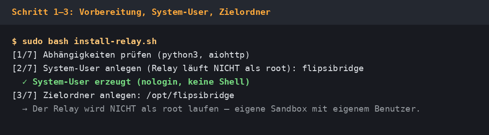
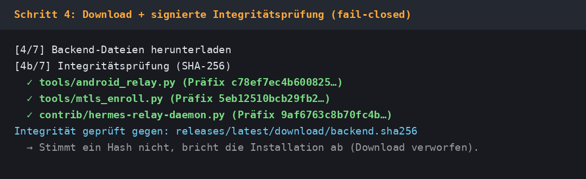
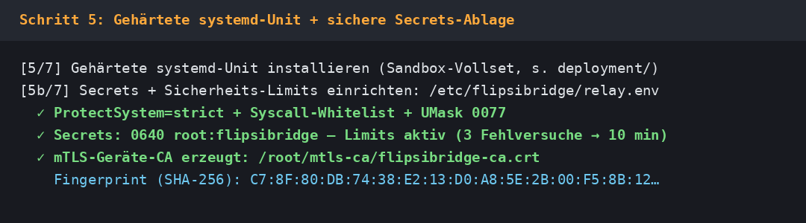
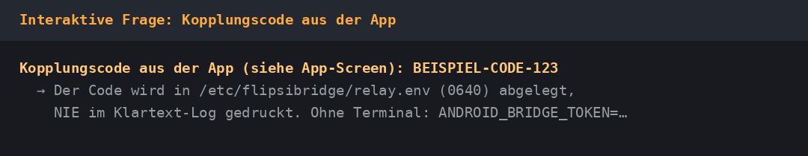
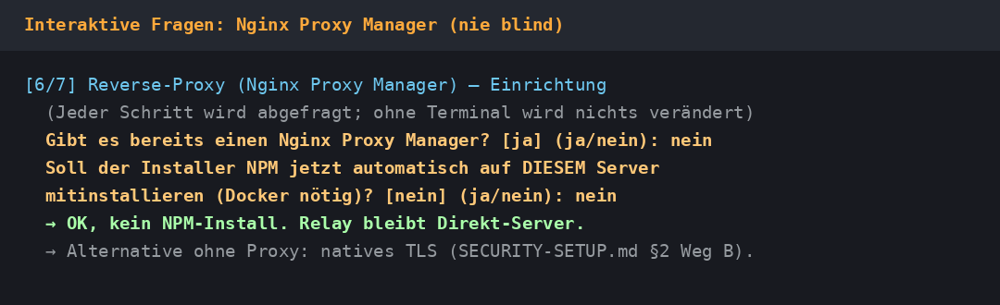
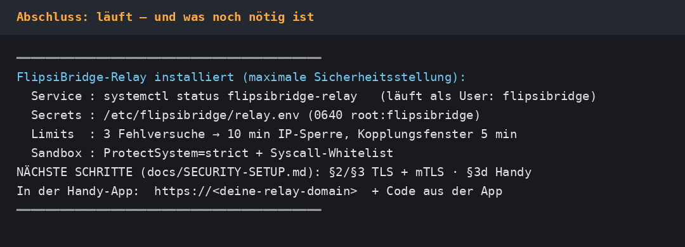
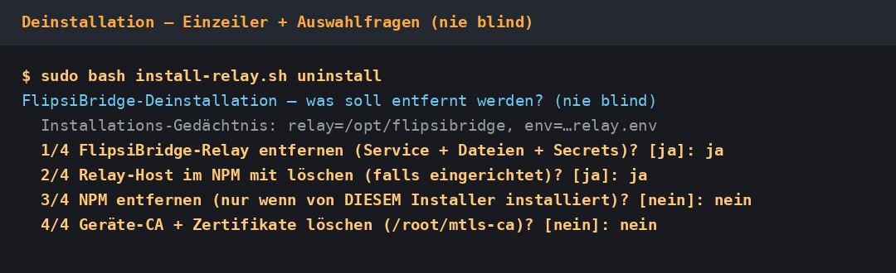
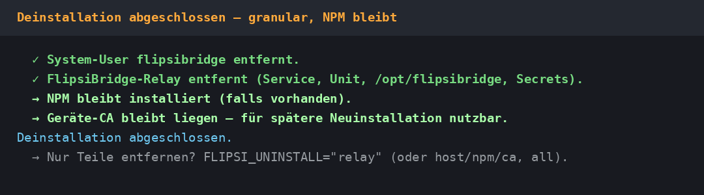

# FlipsiBridge — Autoinstallation & Deinstallation (mit Bildern)

Diese Anleitung führt **Menschen** und **KI-Agenten** durch die vollautomatische Installation und die granulare Deinstallation. Alle Bilder stammen aus einem echten Installationslauf in einem frischen Ubuntu-System.

> **Dokumente-Übersicht:** Sicherheits-Einrichtung Schritt für Schritt → [SECURITY-SETUP.md](SECURITY-SETUP.md) · Diese Anleitung hier = Installieren & Entfernen. **Für KI-Agenten:** Im Repo liegt unter `skills/flipsibridge/` ein fertiger Hermes-Skill mit dem kompletten Software-Wissen (siehe unten).

---

## Voraussetzungen
- Linux-Server mit root-Zugang, `python3` (≥ 3.11), `systemd`, Internetzugriff zu GitHub
- Für den automatischen NPM-Install zusätzlich: Docker + Docker-Compose-Plugin
- Optional (für Domain-Betrieb): eine Domain, deren DNS auf den Server zeigt

## Autoinstallation — ein Befehl

```bash
sudo bash install-relay.sh
```

Der Installer fragt alles ab — nichts wird blind installiert. Ohne Terminal (Agent/CI) steuerst du identisch über `FLIPSI_*`-Umgebungsvariablen (Tabelle unten).

### Schritt 1–3: Vorbereitung, System-User, Zielordner
Der Relay läuft sofort als **eigener System-Benutzer** (keine Shell, kein Login) — nie als root.


### Schritt 4: Download + signierte Integritätsprüfung
Jede Datei wird gegen das SHA-256-Manifest des Releases geprüft. Stimmt ein Hash nicht (oder fehlt eine Datei im Manifest), **bricht die Installation ab** und verwirft die Downloads (fail-closed).


### Schritt 5: Gehärtete systemd-Unit + sichere Secrets
Sandbox-Vollset (`ProtectSystem=strict`, Syscall-Whitelist, UMask 0077), Secrets in `/etc/flipsibridge/relay.env` (0640), strikte Auth-Limits **aktiv ab Installation** (3 Fehlversuche → 10 Minuten IP-Sperre).


### Interaktive Frage: Kopplungscode
Am Terminal fragt der Installer nach dem Kopplungscode aus der App (der Code landet nur in der geschützten Env-Datei — nie im Log).


### Interaktive Fragen: Nginx Proxy Manager
1. **„Gibt es bereits einen Nginx Proxy Manager?"** — bei **nein** folgt die Rückfrage „Jetzt automatisch auf diesem Server mitinstallieren?" (Standard **nein**; bei ja: Docker-Check, Port-Check, Compose-Installation, Admin-Konto mit generiertem Passwort in einer 600-Datei).
2. Bei **ja** (NPM vorhanden): „Relay-Host automatisch einrichten?" → Zertifikat + Proxy-Host + mTLS-Zwang werden angelegt; die **Geräte-CA erzeugt der Installer selbst** (echte, frisch generierte 4096-Bit-CA, kein Standard-Zertifikat). **Geräte-Zertifikate stellt der Installer bewusst NICHT aus** — das machst du gezielt: `bash contrib/flipsibridge-ca.sh issue <gerätename>`.


### Abschluss


**Beweis-Checkliste nach der Installation** (alle Zeilen müssen stimmen):
```bash
systemctl is-active flipsibridge-relay                                   # active
ps -o user= -p "$(systemctl show -p MainPID --value flipsibridge-relay)" # flipsibridge
systemd-analyze security flipsibridge-relay.service                       # niedrige Exposure (~1.5)
stat -c '%a %U:%G' /etc/flipsibridge/relay.env                            # 640 root:flipsibridge
```

---

## Deinstallation — ein Befehl, mit Auswahl

```bash
sudo bash install-relay.sh uninstall
```

Der Deinstallations-Modus fragt **jeden Teil einzeln** ab — du kannst z. B. nur FlipsiBridge entfernen und den Proxy behalten:


1. **Relay entfernen?** (Service + Unit + Ordner + Secrets + System-User)
2. **Relay-Host im NPM mit löschen?** (via NPM-API — nur wenn der Installer ihn eingerichtet hatte; das Installations-Gedächtnis `/etc/flipsibridge/.installer-state` weiß es)
3. **NPM entfernen?** — nur möglich, wenn dieser Installer es selbst installiert hat; danach wahlweise nur Container stoppen oder komplett löschen. Ein NPM, das du selbst installiert hattest, bleibt unangetastet.
4. **Geräte-CA löschen?** (Standard nein — bleibt für spätere Neuinstallationen liegen)



**Ohne Terminal löscht der Modus nichts** — entweder interaktiv am Terminal antworten oder gezielt vorgeben:
```bash
FLIPSI_UNINSTALL="relay" sudo -E bash install-relay.sh uninstall   # nur FlipsiBridge
FLIPSI_UNINSTALL="relay host"  sudo -E bash install-relay.sh uninstall
FLIPSI_UNINSTALL="all"         sudo -E bash install-relay.sh uninstall   # alles inkl. NPM + CA
```

---

## Für Agenten/CI: alles per Umgebungsvariable (kein Terminal nötig)

| Env | Wirkung |
|---|---|
| `ANDROID_BRIDGE_TOKEN=<code>` | Kopplungscode nicht-interaktiv setzen |
| `FLIPSI_NPM_MODE=none` | NPM-Teil überspringen |
| `FLIPSI_NPM_INSTALL=1` | NPM automatisch mitinstallieren (Docker nötig) |
| `FLIPSI_NPM_AUTOSETUP=1` | Relay-Host automatisch im bestehenden NPM einrichten |
| `FLIPSI_NPM_URL` / `FLIPSI_NPM_EMAIL` / `FLIPSI_NPM_PASSWORD` | NPM-API-Zugang |
| `FLIPSI_RELAY_DOMAIN` / `FLIPSI_LE_EMAIL` | Domain + Let's-Encrypt-E-Mail |
| `FLIPSI_UNINSTALL="relay host npm ca"` oder `all` | Granulare Deinstallation |

**Ohne Terminal und ohne Env-Vorgabe passiert am Proxy nichts** — der Installer überspringt den Teil mit klarer Nachhol-Anleitung (nie blind).

---

## Der FlipsiBridge-Skill für KI-Agenten

Im Repository liegt unter **`skills/flipsibridge/`** ein fertiger **Hermes-Agenten-Skill**: das komplette Software-Wissen über FlipsiBridge (Architektur, Endpunkte, Auth-Schichten, Env-Variablen, Install/Update/Deinstall, Debug- und Verifikations-Rezepte, Sicherheits-Regeln) — **ohne jedwede privaten Daten** (keine Domains, IPs, Tokens oder personenbezogenen Angaben). Andere Hermes-Instanzen kopieren/verlinken diesen Skill in ihr Skills-Verzeichnis und können damit FlipsiBridge perfekt betreuen:

```
cp -r skills/flipsibridge/ <hermes-home>/skills/
```

Der Skill verweist auf diese Anleitung und das [SECURITY-SETUP.md](SECURITY-SETUP.md) — die drei Dokumente zusammen sind die vollständige Referenz.
